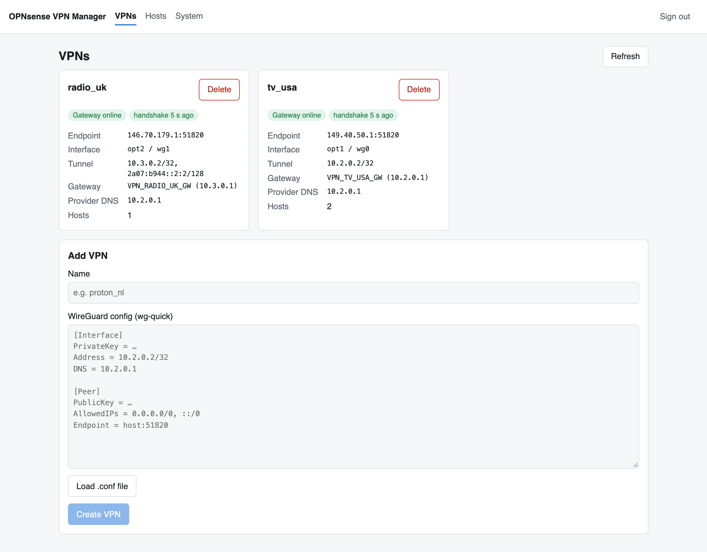
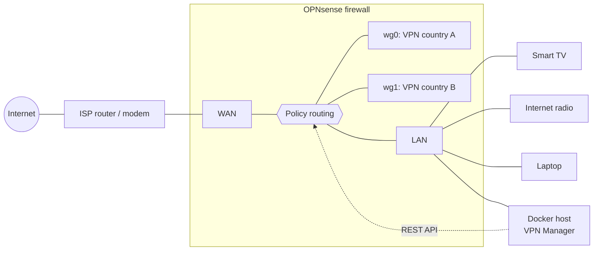

# OPNsense VPN Manager

Route individual devices in your home network through different VPN locations
with one click – the smart TV through the USA, the kitchen radio through the UK,
everything else through your normal internet connection.

The VPN Manager is a small web app that talks to the
[OPNsense](https://opnsense.org) firewall API. You paste a WireGuard config from
your VPN provider (for example [Proton VPN](https://protonvpn.com)), and it sets
up everything OPNsense needs: the WireGuard tunnel, interface, gateway, NAT and
policy-routing rules including a kill switch. Afterwards you pick a VPN for each
device from a list.



## Features

- **Add a VPN in one step** – paste a `wg-quick` config (or upload the `.conf`
  file), give it a name, done. No clicking through the OPNsense GUI.
- **Per-device routing** – every device in the network can use a different VPN
  or none at all. Changes take effect within seconds, existing connections are
  reset so they switch over immediately.
- **Kill switch** – if a tunnel goes down, devices assigned to it lose internet
  access instead of leaking through your normal connection. The local network
  stays reachable.
- **Several tunnels to the same provider** – Proton VPN puts the same tunnel
  address (`10.2.0.2`) into every config; the VPN Manager adjusts it
  automatically so you can run many tunnels in parallel.
- **Safe changes** – every step is logged; if anything fails, all changes made
  so far are rolled back. Deleting a VPN removes every object it created.
- **OPNsense stays the source of truth** – the app only touches objects it
  created itself (marked with `vpnmgr`), and stores no secrets.

## Typical use cases

| Device | Routed through | Why |
|---|---|---|
| Smart TV | VPN in country A | Use the streaming catalogue of your home country while abroad |
| Internet radio | VPN in country B | Stations that only stream within their country |
| Game console | VPN close to the game servers | Different region / matchmaking |
| Tablet of the kids | VPN with ad and tracker blocking (e.g. Proton NetShield) | Fewer ads and trackers without installing an app |
| Work laptop | No VPN | Company VPN and video calls keep working normally |

More examples: [docs/use-cases.md](docs/use-cases.md).

> Please respect the terms of service of the streaming and content providers you
> use. This project only provides the routing.

## How it works



For every VPN the VPN Manager creates in OPNsense: a WireGuard peer and instance,
an interface assignment, a gateway with monitoring, an alias holding the
assigned devices, a source NAT rule and three firewall rules (local networks →
direct, everything else → VPN gateway, otherwise → block). Assigning a device
just adds or removes its IP address from the alias. Details:
[docs/how-it-works.md](docs/how-it-works.md).

## Requirements

- A PC (or VM) with **two network ports** running **OPNsense 26.7.7 or newer** –
  see [hardware requirements](docs/hardware.md)
- A VPN subscription that offers **WireGuard configs for routers**, e.g. Proton VPN
- A machine in your network that runs **Docker** (mini PC, NAS, Raspberry Pi, …)

## Quick start

If OPNsense is already running and you have an API key (otherwise follow the
[setup guide](docs/setup-guide.md)):

```bash
git clone https://github.com/jowin202/VPNManager.git
cd VPNManager
cp .env.example .env        # fill in OPNsense URL, API key/secret and a token
docker compose up -d --build
```

Open `http://<docker-host>:8000` and sign in with the `VPNMGR_API_TOKEN` from
your `.env`.

A prebuilt multi-arch image (amd64/arm64) can be published to the GitHub
Container Registry with the manually triggered
[Build Docker image](.github/workflows/docker.yml) workflow
(Actions → *Build Docker image* → *Run workflow*). Then use
`image: ghcr.io/jowin202/vpnmanager:latest` in `docker-compose.yml`.

## Documentation

| | |
|---|---|
| [Hardware requirements](docs/hardware.md) | What you need and how to wire it |
| [Setup guide](docs/setup-guide.md) | Step by step: OPNsense, API user, Proton VPN, VPN Manager |
| [Using the VPN Manager](docs/usage.md) | Adding VPNs, assigning devices, deleting |
| [Use cases](docs/use-cases.md) | Ideas and example setups |
| [Configuration reference](docs/configuration.md) | All environment variables |
| [How it works](docs/how-it-works.md) | What is created in OPNsense and why |
| [Troubleshooting](docs/troubleshooting.md) | Gateway offline, slow speed, errors |
| [Development](docs/development.md) | Running tests, simulated OPNsense, API notes |

## Security

- The app can change your firewall. It requires a sign-in token
  (`VPNMGR_API_TOKEN`) and should only be reachable from your local network.
- Use a dedicated OPNsense user with only the [required privileges](docs/setup-guide.md#4-create-an-api-user-in-opnsense).
- Private keys are passed to OPNsense once and are never logged or shown again.
- Never commit your `.env` or VPN `.conf` files – they are in `.gitignore`.

See [SECURITY.md](SECURITY.md) for reporting vulnerabilities.

## Limitations

- Assignments are by IP address – devices need a fixed IP or a DHCP reservation.
- Only IPv4 is routed through the VPNs. Disable IPv6 on the LAN or for the
  devices concerned if they must not bypass the VPN via IPv6.
- Devices behind another router (double NAT) appear as one device – the router.

## Disclaimer

This is an independent project. It is not affiliated with or endorsed by
Deciso B.V. (OPNsense) or Proton AG (Proton VPN). Use at your own risk.

## License

[MIT](LICENSE)
