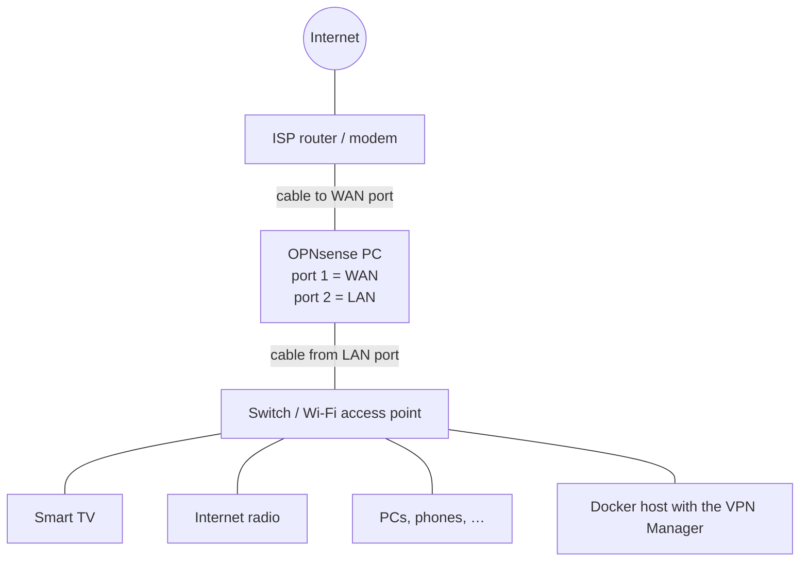

# Hardware requirements

You need two things: a **firewall PC** that runs OPNsense and sits between your
internet connection and your home network, and a **Docker host** somewhere in
your network that runs the VPN Manager.

## Network layout

All devices that should be routed through a VPN must be connected **behind** the
OPNsense LAN port – via cable, a switch, or a Wi-Fi access point.

- Put your existing Wi-Fi router into **access point / bridge mode** so that the
  devices get their addresses from OPNsense. If the Wi-Fi router keeps its own
  routing (NAT), OPNsense only sees the router, and all devices behind it can
  only be routed together.
- The ISP router can stay as it is (OPNsense then gets a private address on WAN –
  "double NAT"). This works fine for VPN routing. If you prefer, put the ISP
  router into bridge mode so OPNsense gets the public IP.

## Firewall PC (OPNsense)

| | Minimum | Recommended |
|---|---|---|
| CPU | 64-bit x86 (amd64), 2 cores | 4 cores, e.g. Intel N100/N150 or better |
| RAM | 4 GB | 8 GB |
| Storage | 32 GB SSD | 64–128 GB SSD |
| Network | **2 Ethernet ports** | 2+ Intel ports (i210/i211/i225/i226) |

Notes:

- **Two network ports are required** – one for WAN (towards the internet) and one
  for LAN (towards your devices). A USB Ethernet adapter can work but is not
  recommended for permanent use.
- Popular choices are fanless mini PCs with 2–6 Intel 2.5 GbE ports. Intel
  network cards have the best driver support in FreeBSD/OPNsense.
- OPNsense does not run on ARM devices such as the Raspberry Pi.
- **VPN speed depends on the CPU.** WireGuard encrypts every packet in software.
  A modern quad-core mini PC can usually saturate a typical home internet
  connection through WireGuard; old dual-core Atom/Celeron systems are much
  slower.

### Running OPNsense in a virtual machine

OPNsense also runs in Proxmox, VMware, Hyper-V or VirtualBox – handy for testing.

- Give the VM two network adapters: one bridged to the network towards the
  internet (WAN), one to the network of your devices (LAN).
- Use **paravirtualised network adapters** (virtio-net, shown as `vtnet0` in
  OPNsense) or emulated Intel adapters (`em0`). The default *AMD PCnet* adapter
  in some VirtualBox setups (`le0`) is extremely slow.
- Assign at least 2 CPU cores.

## Docker host (VPN Manager)

Anything that runs Docker and is in your LAN works: a Raspberry Pi 4/5, a NAS
with Docker support (Synology, QNAP, Unraid, TrueNAS), a mini PC or a home
server. The image is available for `linux/amd64` and `linux/arm64`.

- RAM: ~100 MB, CPU usage is negligible.
- It must be able to reach the OPNsense web interface (HTTPS, port 443 by default).
- Ideally give it a fixed IP and keep it **outside** of any VPN, so that you can
  always reach the VPN Manager.

The VPN Manager cannot run on the OPNsense box itself – OPNsense is based on
FreeBSD and does not support Docker.
