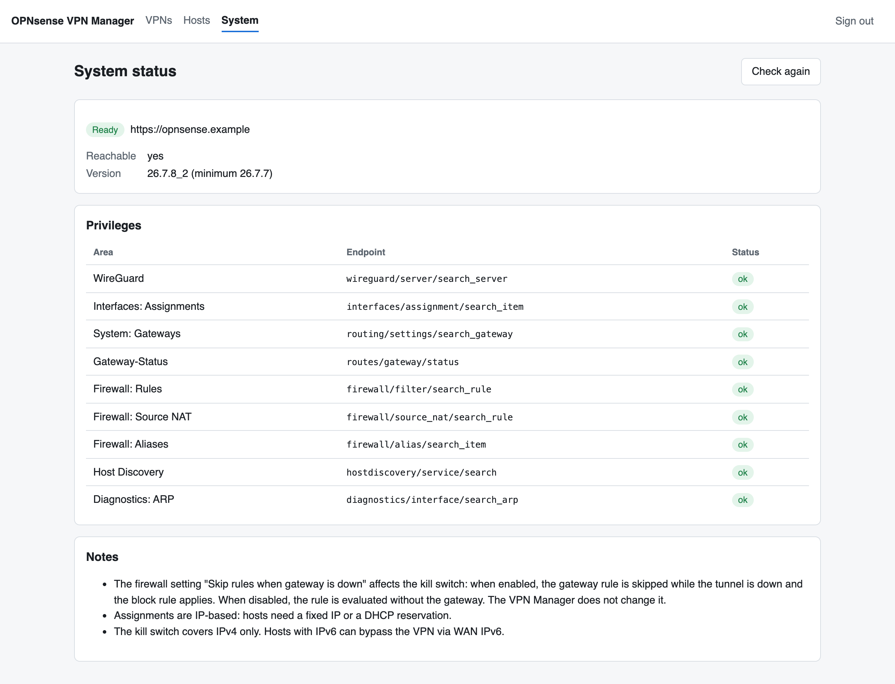
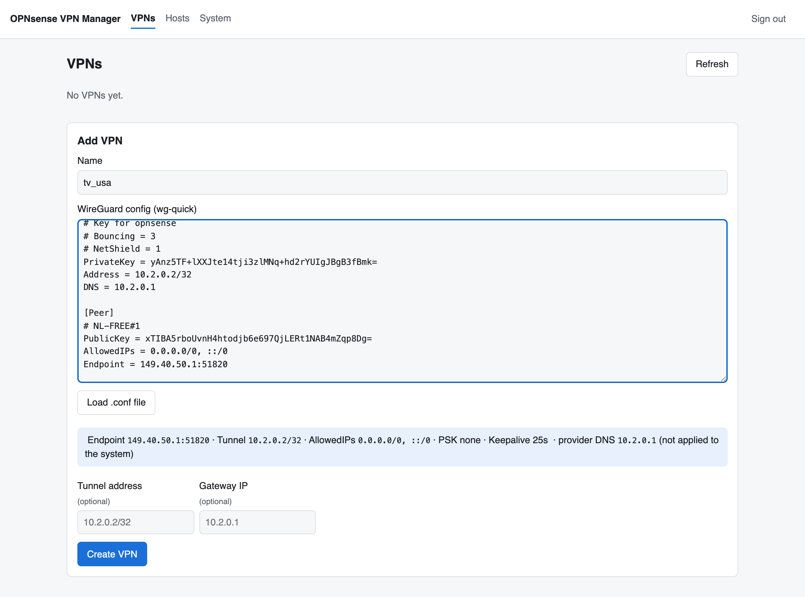
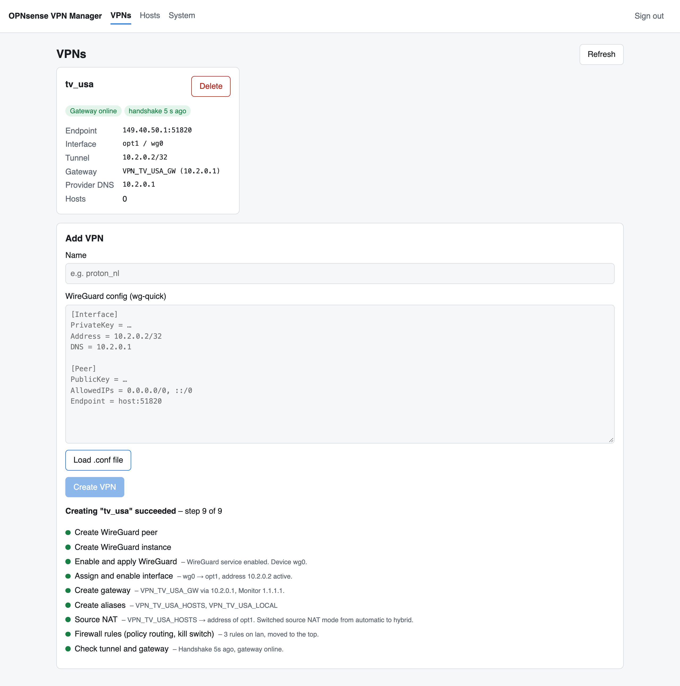
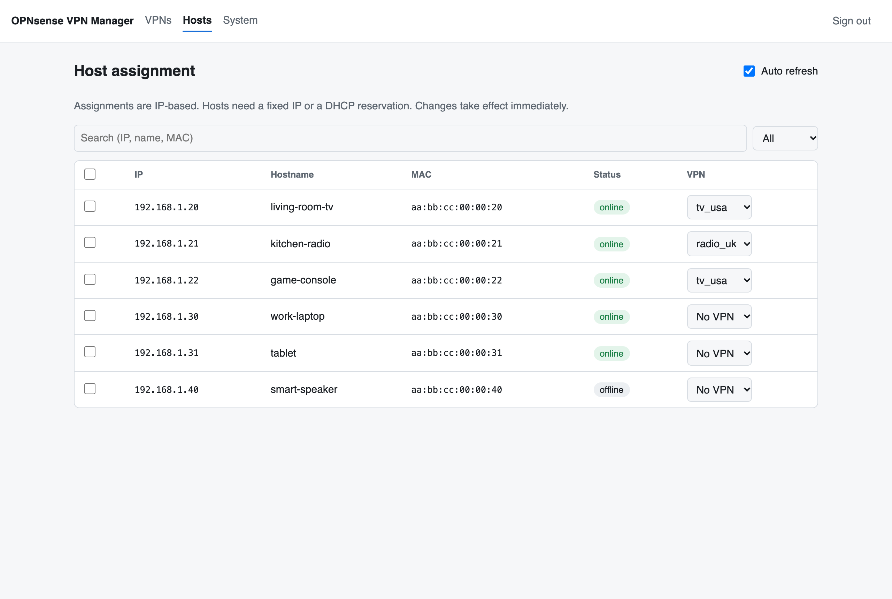

# Setup guide

This guide takes you from an empty PC to devices being routed through VPN
locations. Allow about one to two hours if you are setting up OPNsense for the
first time.

1. [Plan the network](#1-plan-the-network)
2. [Install OPNsense](#2-install-opnsense)
3. [Basic OPNsense configuration](#3-basic-opnsense-configuration)
4. [Create an API user in OPNsense](#4-create-an-api-user-in-opnsense)
5. [Get WireGuard configs from Proton VPN](#5-get-wireguard-configs-from-proton-vpn)
6. [Install the VPN Manager](#6-install-the-vpn-manager)
7. [Add your first VPN and assign a device](#7-add-your-first-vpn-and-assign-a-device)
8. [Keeping things up to date](#8-keeping-things-up-to-date)

> Menu names refer to OPNsense 26.7. They can differ slightly between versions.

---

## 1. Plan the network

Read [hardware requirements](hardware.md) first. In short:

- The OPNsense PC has two ports: **WAN** goes to your ISP router/modem, **LAN**
  goes to a switch or Wi-Fi access point where your devices are connected.
- Decide on the LAN network. This guide uses the OPNsense default
  `192.168.1.0/24` with the firewall at `192.168.1.1`. If your ISP router already
  uses `192.168.1.x`, choose a different LAN network for OPNsense (for example
  `192.168.10.1/24`), because WAN and LAN must not overlap.
- Pick a machine for Docker (Raspberry Pi, NAS, mini PC, …) that is connected to
  the OPNsense LAN.

## 2. Install OPNsense

1. Download the installer from <https://opnsense.org/download/>:
   architecture **amd64**, image type **vga** (USB stick image). Pick a mirror
   close to you.
2. Unpack the downloaded `.bz2` file and write the `.img` to a USB stick with
   [balenaEtcher](https://etcher.balena.io/), [Rufus](https://rufus.ie/) or `dd`.
   All data on the stick is erased.
3. Connect a monitor and keyboard to the firewall PC, plug in the USB stick and
   boot from it (boot menu key is usually F11, F12 or Esc).
4. When the live system has started, log in as user **`installer`** with
   password **`opnsense`**.
5. Follow the installer: keyboard layout → **Install (ZFS)** (or UFS on small
   disks) → select the internal SSD → confirm. Set a strong **root password**
   when asked, then reboot and remove the USB stick.
6. After the reboot, the console menu appears. If the WAN and LAN ports were
   detected the wrong way round, choose **1) Assign interfaces** and assign them
   correctly (unplugging and replugging a cable helps to identify ports).
   If you want a LAN network other than `192.168.1.0/24`, choose
   **2) Set interface IP address** for LAN and enable the DHCP server when asked.

Connect a computer to the LAN side and open **https://192.168.1.1** in a
browser. Accept the certificate warning (OPNsense uses a self-signed certificate)
and log in as `root`.

## 3. Basic OPNsense configuration

### 3.1 Setup wizard

The first login starts a wizard. Set hostname, domain, time zone and DNS
servers; for WAN usually **DHCP** is correct when OPNsense is behind an ISP
router. Keep the LAN settings and finish the wizard.

### 3.2 Update to the latest version

The VPN Manager needs **OPNsense 26.7.7 or newer**.

**System → Firmware → Status** → *Check for updates* → *Update*. The firewall
may reboot. Repeat until no more updates are offered.

### 3.3 Give your devices fixed addresses

Assignments in the VPN Manager are based on IP addresses, so every device you
want to route needs an address that never changes. Create a DHCP reservation
for each such device (you find the MAC address in the device's network settings
or in **Services → DHCP leases** of OPNsense):

- **Dnsmasq** (default DHCP server on new installations):
  **Services → Dnsmasq DNS & DHCP → Hosts** → add host name, IP address and
  hardware (MAC) address.
- **Kea DHCP**: **Services → Kea DHCP → Kea DHCPv4 → Reservations**.

Restart the device (or reconnect it) so that it gets its reserved address.

### 3.4 Optional: switch Wi-Fi router to access point mode

If your devices use Wi-Fi from a separate router, set that router to access
point / bridge mode (see its manual). Otherwise OPNsense only sees the router
and can only route all its devices together.

## 4. Create an API user in OPNsense

The VPN Manager talks to OPNsense through its REST API with a dedicated user.

### 4.1 Group with the required privileges

**System → Access → Groups → +**

- Name: `vpnmgr`
- **Privileges** – add these (use the search field):
  - `VPN: WireGuard`
  - `Interfaces: Assignments` (and the interface settings entry if listed separately)
  - `System: Gateways`, `Status: Gateways`
  - `Firewall: Rules`, `Firewall: Source NAT`, `Firewall: Alias`, `Firewall: Alias utility`
  - `Diagnostics: ARP Table`, `Diagnostics: States`, `Diagnostics: Interface`
  - `Host discovery`
  - `Services: Dnsmasq DNS & DHCP` and/or `Services: Kea DHCP` (to read leases)
  - `System: Firmware` (only used to read the version)
- Save.

If a privilege is missing, the **System** page of the VPN Manager shows it in
red, so you can also start with this list and add what is reported.

### 4.2 User

**System → Access → Users → +**

- Username: `vpnmgr`
- Password: generate a random one (the user never logs in to the web GUI)
- Login shell: none
- Group membership: `vpnmgr`
- Save.

### 4.3 API key

Open the user again and click **+** in the **API keys** section (or the key
icon in the user list). OPNsense downloads a file `apikey.txt`:

```
key=...
secret=...
```

The secret is shown **only once**. Keep the file until you have entered both
values into the VPN Manager configuration, then delete it.

## 5. Get WireGuard configs from Proton VPN

Any provider that offers WireGuard configuration files for routers works
(Mullvad, IVPN, AirVPN, …). This section uses Proton VPN.

1. Create an account at <https://protonvpn.com>. The free plan offers a few
   countries; to choose any country you need a paid plan (Proton VPN Plus or a
   Proton bundle). Check how many devices your plan allows – every downloaded
   config counts as one.
2. Sign in at <https://account.protonvpn.com> → **Downloads** →
   **WireGuard configuration**.
3. Fill in the form:
   - **Name**: something recognisable, e.g. `opnsense-tv-usa` (shown in your
     account so you can revoke it later)
   - **Platform**: **Router**
   - **VPN options**: *NetShield* as you like (blocks malware/ads via DNS – only
     effective if the device uses the Proton DNS), *Moderate NAT* off,
     *NAT-PMP (Port forwarding)* off, *VPN Accelerator* on
4. Choose a server (standard servers; country and server load are shown) and
   click **Create**, then **Download**. You get a `.conf` file like:

   ```ini
   [Interface]
   PrivateKey = <secret>
   Address = 10.2.0.2/32
   DNS = 10.2.0.1

   [Peer]
   PublicKey = <server key>
   AllowedIPs = 0.0.0.0/0, ::/0
   Endpoint = 203.0.113.10:51820
   ```

5. Repeat for every country you want. Use **one config per VPN** – the same
   config must not be used for two tunnels at the same time.

Treat these files like passwords: anyone with the file can use your VPN
subscription. If one leaks, delete it in the Proton account (it is revoked
immediately) and create a new one.

> All Proton configs use the same address `10.2.0.2`. That is expected – the VPN
> Manager detects it and gives each additional tunnel its own address
> (`10.3.0.2`, `10.4.0.2`, …).

## 6. Install the VPN Manager

### 6.1 Docker

Install Docker on your Docker host:
[Docker Engine for Linux](https://docs.docker.com/engine/install/) (Raspberry Pi
OS, Debian, Ubuntu, …), the Docker / Container Manager app on your NAS, or
[Docker Desktop](https://docs.docker.com/desktop/) on macOS/Windows.

### 6.2 Get the VPN Manager

```bash
git clone https://github.com/jowin202/VPNManager.git
cd VPNManager
cp .env.example .env
```

### 6.3 Configure

Edit `.env`:

```ini
OPNSENSE_URL=https://192.168.1.1
OPNSENSE_API_KEY=<key from apikey.txt>
OPNSENSE_API_SECRET=<secret from apikey.txt>
OPNSENSE_VERIFY_TLS=false
VPNMGR_API_TOKEN=<random token>
```

Create the token with `openssl rand -hex 24` (or any password generator, at
least 16 characters). You use it to sign in to the VPN Manager.

**About `OPNSENSE_VERIFY_TLS`:** OPNsense uses a self-signed certificate issued
for its host name (e.g. `OPNsense.internal`), not for its IP address, so normal
certificate checks fail. In a home network `false` is acceptable – the
connection is still encrypted, the app just logs a warning. To verify the
certificate properly:

1. **System → Trust → Certificates** → download the certificate of the web GUI.
2. Save it next to `docker-compose.yml` as `opnsense.pem` and mount it:
   ```yaml
       volumes:
         - ./data:/app/data
         - ./opnsense.pem:/certs/opnsense.pem:ro
   ```
3. Set `OPNSENSE_VERIFY_TLS=/certs/opnsense.pem` and use the host name from the
   certificate in `OPNSENSE_URL` (it must resolve via your DNS, for example
   through a host override in OPNsense).

All options are described in the [configuration reference](configuration.md).

### 6.4 Start

```bash
docker compose up -d --build
docker compose logs -f
```

The log should show `Detected OPNsense 26.7.x` and
`Uvicorn running on http://0.0.0.0:8000`. Open `http://<docker-host>:8000` and
sign in with your token.

Check the **System** page first: it must show *Ready*, the OPNsense version and
all privileges as *ok*.



## 7. Add your first VPN and assign a device

1. On the **VPNs** page, enter a name (letters, digits, `_`, e.g. `tv_usa`) and
   paste the content of the `.conf` file, or use **Load .conf file**. A preview
   shows endpoint, tunnel address and DNS.

   

2. Click **Create VPN**. The steps are shown live; after about a minute all of
   them should be green. Right after creation the gateway can show
   *monitoring starting* for a minute – that is normal.

   

3. Go to **Hosts**, find your device and select the VPN in its row. The change
   is active within seconds.

   

4. Check on the device: open <https://ipinfo.io> in a browser on that device
   (or the device's network info). It should show an IP address in the VPN's
   country. Set the device back to **No VPN** and it shows your own IP again.

## 8. Keeping things up to date

- **OPNsense**: *System → Firmware → Status → Check for updates* regularly.
- **VPN Manager**: `git pull && docker compose up -d --build` (or pull the new
  image if you use the prebuilt one).
- **Proton configs** do not expire, but if you delete a config in your Proton
  account, delete the VPN in the VPN Manager as well and add a new one.

Next: [Using the VPN Manager](usage.md) · [Use cases](use-cases.md) ·
[Troubleshooting](troubleshooting.md)
