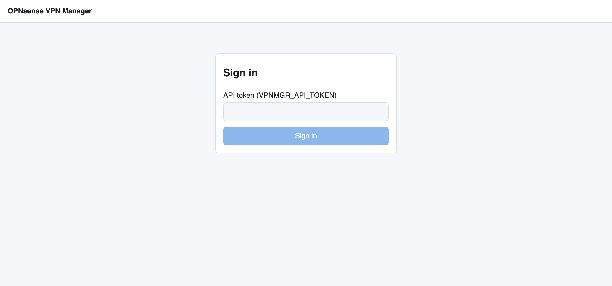
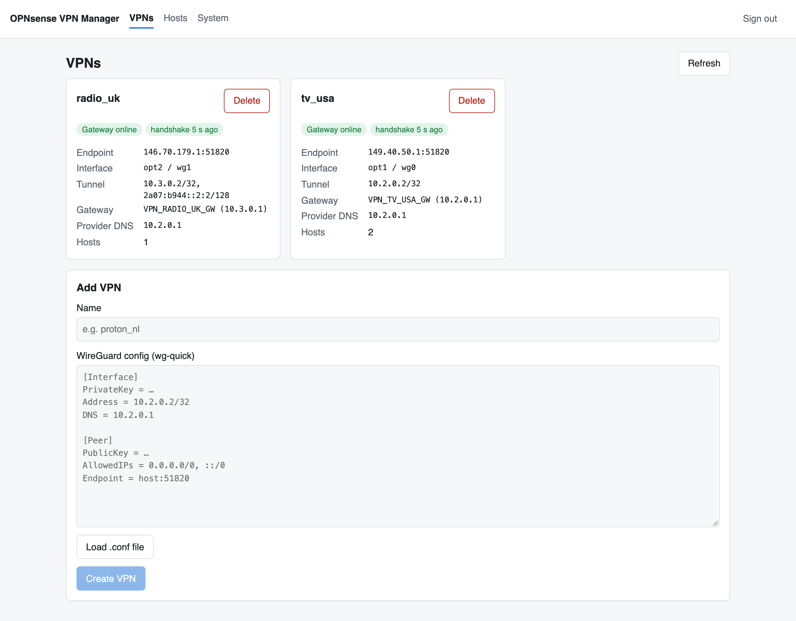
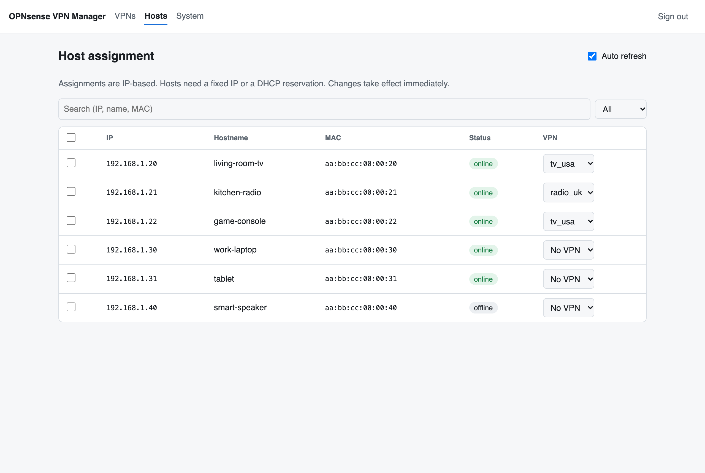
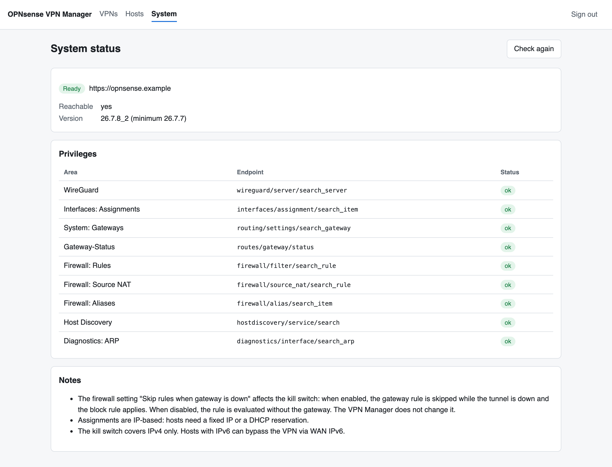

# Using the VPN Manager

## Sign in

Open `http://<docker-host>:8000` and enter the `VPNMGR_API_TOKEN` from your
`.env`. The token is stored in the browser; use **Sign out** to remove it.

## VPNs

Each card shows one VPN:

| Field | Meaning |
|---|---|
| Gateway online / degraded / offline | Result of the OPNsense gateway monitoring (pings through the tunnel). *Monitoring starting* is shown for the first minutes after creation. |
| handshake … ago | Time since the last WireGuard handshake with the VPN server. Handshakes happen every 2 minutes while traffic flows; older than 3 minutes means the tunnel is probably not working. |
| Endpoint | The VPN server |
| Interface | OPNsense interface (`optX`) and WireGuard device (`wgN`) |
| Tunnel | Tunnel address(es) used on the OPNsense side |
| Gateway | Gateway name and next-hop address |
| Provider DNS | DNS server from the config – shown for information only, it is not configured anywhere |
| Hosts | Number of devices assigned to this VPN |

The page refreshes every 15 seconds.

### Add a VPN

1. **Name** – 1–16 characters, letters, digits and `_`, starting with a letter.
   It becomes part of the OPNsense object names (`VPN_<NAME>_GW`, …).
2. **WireGuard config** – paste the `.conf` content or use **Load .conf file**.
   The preview shows what was understood. Errors (missing key, invalid address,
   more than one `[Peer]`) are shown immediately.
3. Optional: **Tunnel address** and **Gateway IP** – leave empty unless you know
   you need specific values. If the config's tunnel address is already used by
   another VPN (always the case with several Proton configs), a free one is
   chosen automatically and the preview says so.
4. **Create VPN** – the step log shows progress. If a step fails, everything
   already created is rolled back and the log shows what was undone.

If OPNsense has unapplied interface changes from the GUI, creating a VPN stops
with a message, because applying would include them. Apply or discard them in
OPNsense, or tick *Also apply the pending interface changes* and try again.

### Delete a VPN

**Delete** shows which devices are still assigned. After confirming, all
objects of this VPN are removed from OPNsense and the devices go back to the
normal internet connection.

## Hosts

The list combines OPNsense host discovery, DHCP leases and the ARP table.
Devices that are assigned to a VPN but currently off are shown as *offline*.

- **Assign** – pick a VPN in the device's row. *No VPN* means the normal
  internet connection. A device can only be in one VPN.
- **Several devices** – tick the checkboxes, choose the target in the toolbar and
  click **Assign**.
- **Search / filter** – by IP, name or MAC, or show only the devices of one VPN.

Changing the assignment resets the device's open connections so that they are
re-established through the new route. Streaming apps may need a restart to
notice the new location.

## System

Shows whether OPNsense is reachable, its version and whether the API user has
all required privileges. Check this page first when something does not work.
